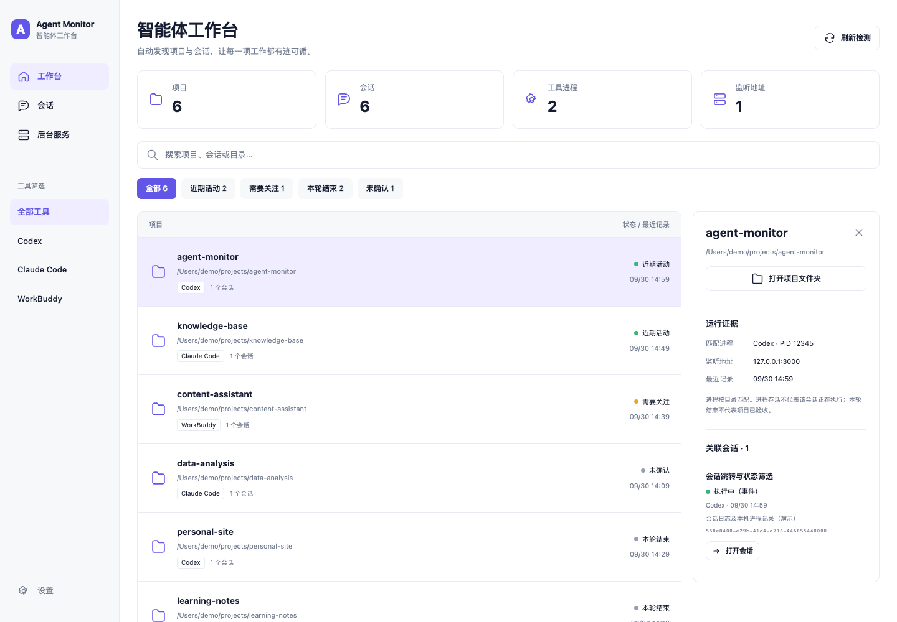

# Agent Monitor · 智能体工作台

An Obsidian desktop dashboard for local **Codex, Claude Code, and WorkBuddy** projects, sessions, processes, and listening services.

同时运行多个智能体时，在一个工作台里查看谁在做什么、哪些记录需要关注，以及哪些后台服务仍在运行。



The screenshot uses fictional demonstration data. No personal session records are published.

## Features / 功能

- Discover recent local sessions automatically, grouped by project directory.
- Search projects and sessions; filter by tool and recorded activity state.
- Inspect session evidence, matching process IDs, working directories, and TCP listening addresses.
- Open Codex and WorkBuddy sessions through local app links.
- Copy a correctly quoted `claude --resume` command for Claude Code sessions.
- Refresh every 30 seconds while enabled; supports manual refresh, light/dark themes, and narrow windows.
- Scroll the whole page so the header does not reduce the usable list area.

“本轮已结束”只表示一次工具响应结束，不表示项目已验收。近期日志活动不证明正在推理；进程与会话按目录匹配，也不能证明属于同一个会话。没有明确证据的状态会标为“未确认”。

## Requirements / 运行要求

- Obsidian **1.13.7 or later**, desktop.
- **macOS**. Automatic detection is currently unsupported on Windows and Linux.
- Python **3.9 or later**, installed by the user. The plugin does not install Python or other dependencies. The default interpreter is `/usr/bin/python3`; configure another absolute path in plugin settings if needed.
- macOS `ps` and `lsof`, and locally installed supported agent tools.

The interface is currently in Chinese. Agents do not need to be running for their recent saved sessions to appear. Each source is limited to 300 recent sessions; default history is 14 days.

## Install / 安装

Community directory submission is pending. Until listed, use a GitHub release:

1. Download `main.js`, `manifest.json`, and `styles.css` from [Releases](https://github.com/zackzhangkai/obsidian-agent-monitor/releases).
2. Create `<vault>/.obsidian/plugins/agent-monitor/` and put those three files inside it.
3. Reload Obsidian and enable **Agent Monitor** under Community plugins.
4. Click the dashboard ribbon icon, or use the command **Agent Monitor: 打开智能体工作台**.

The release is self-contained: the readable Python detector is embedded in `main.js`. No fourth file is required by Obsidian's community installer.

## Settings / 使用

Select a project to see related sessions and their evidence. Each session includes an **打开会话** button for Codex/WorkBuddy, or **复制恢复命令** for Claude Code. The plugin does not send a prompt or automatically execute a copied resume command.

Plugin settings configure the data directory, Python interpreter, and 7/14/30-day history. A stale-data banner appears when the snapshot has not been updated for two minutes.

The plugin scans only while it is enabled and Obsidian is open. It does **not** install a login service. If a user separately runs a compatible detector, the plugin can read its snapshot and skip duplicate recent scans.

## Privacy and external file access / 隐私与外部文件访问

This plugin intentionally reads files **outside the Obsidian vault** to discover agent sessions:

| Source | Read-only locations and information |
| --- | --- |
| Codex | `~/.codex/state_5.sqlite`, and rollout log paths recorded by that database; session ID, title, directory, update time and execution events |
| Claude Code | `~/.claude/projects/*/*.jsonl`; session metadata and recent tool/turn-end event types |
| WorkBuddy | `~/.workbuddy/workbuddy.db`; session ID, title, directory, time and recorded status |
| macOS | `ps` process names/IDs and `lsof` working directories/TCP listening addresses |

SQLite connections are read-only. Log reading is bounded to recent records and a small tail (plus up to 30 initial Claude metadata lines when necessary). Parsing may read transcript content in those chunks, but the dashboard does not display transcript bodies or tool command arguments. Agent-provided session titles can contain excerpts of a user prompt.

It writes `snapshot.json`, a generated Markdown dashboard, and a lock file to `~/Library/Application Support/AgentMonitor/dashboard/` by default. The output contains local project paths and session titles. Keep that folder private; do not publish a real snapshot or screenshot containing confidential projects.

There is **no telemetry, background network request, remote AI call, account requirement, or payment**. Clicking a session link delegates to the installed local application. No original agent database, session log, existing vault note, or agent configuration is modified. No monitored process is stopped.

## Development

No npm dependencies are needed:

```sh
npm run build
npm test
```

- `src/main.js`: Obsidian view, settings and process adapter.
- `src/dashboard.js`: UI, project grouping and session navigation.
- `src/monitor.py`: standard-library detector.
- `build.js`: bundles the dashboard and detector into the release entry.
- `tests/`: parsing, grouping, quoting and standalone plugin loading checks.

Release tags must equal the version in `manifest.json` (for example `1.0.3`, without a `v` prefix). Upload `main.js`, `manifest.json`, and `styles.css` as release assets.

## Support and community / 联系与交流

- [GitHub issues](https://github.com/zackzhangkai/obsidian-agent-monitor/issues)
- X: [@kaiz_amm](https://x.com/kaiz_amm)

Additional community contact details are pending explicit authorization for public distribution.

## License

[MIT](LICENSE). This is an independent community project, unaffiliated with Obsidian, OpenAI, Anthropic, or Tencent.
